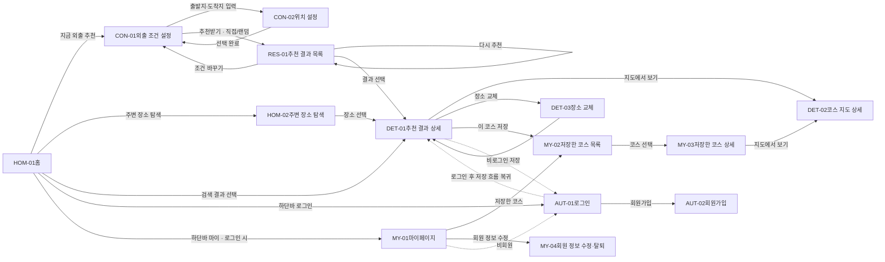

화면설계서 · 최종본 v2.0

# 틈틈 (TMEUM)

남는 시간에 갈 만한 곳을 추천하는 서비스입니다. 한 화면에서 위치·시간·이동수단·카테고리를 고르면, 시간 안에 다녀올 수 있는 코스(장소 1곳 이상)를 추천합니다. 모바일 우선으로 설계하고 추후 PC 반응형으로 확장합니다. 와이어프레임 안의 버튼을 누르면 이동할 화면으로 넘어갑니다.

작성일 **2026-11-11** 근거 **11/10 회의 화이트보드 · 화면별 기능 요구사항 정리본 · 외부 API 화면별 연동 가이드** 화면 수 **주요 5 · 연결 9** v2.0 **결정 9건 모두 확정 · 외부 API 연동 가이드 반영** v1.0 **홈 검색창·하단바 · 주변 탐색 바텀시트 · 조건 설정 한 화면 통합(카테고리 포함) · 자전거 삭제**

정책 보완 **2026-11-12** · MY-03 저장본 유지·최신 조회 정보 분리 ([#7](https://github.com/teumteum-sesac/teumteum/issues/7)). 상세 기준: [REQ-030/031](requirements.md#15-코스-저장-및-관리).

## 화면 목록

### 1. 홈

[HOM-01홈 / 바로 추천](#home) [HOM-02주변 장소 탐색연결](#nearby)

### 2. 외출 조건

[CON-01외출 조건 설정](#cond) [CON-02위치 설정연결](#loc)

### 3. 추천 결과

[RES-01추천 결과 목록](#result)

### 4. 결과 상세

[DET-01추천 결과 상세](#detail) [DET-02코스 지도 상세연결](#map) [DET-03장소 교체연결](#swap)

### 5. 회원 · 마이페이지

[MY-01마이페이지](#mypage) [MY-02저장한 코스 목록연결](#saved) [MY-03저장한 코스 상세연결](#saved-detail) [MY-04회원 정보 수정 · 탈퇴연결](#account) [AUT-01로그인연결](#login) [AUT-02회원가입연결](#signup)

## 전체 화면 흐름

실선: 기본 이동점선: 비회원일 때 로그인으로 우회 · 로그인 후 복귀하단바(홈 · 주변 탐색 · 저장한 코스 · 로그인/마이)는 홈과 주변 탐색에서 고정

## 화면별 사용 API

| 화면 | 사용 API | 화면에 보이는 영향 |
| --- | --- | --- |
| HOM-01 · HOM-02 | 카카오맵 JS SDK · 브라우저 위치(Geolocation) · 카카오 로컬(검색·주변 장소) | 위치 거부 시 서울시청 기준 지도 + “위치를 직접 설정해 주세요” |
| CON-01 · CON-02 | Geolocation · 카카오 로컬(키워드·주소 검색) | 검색은 입력이 멈추고 0.3초 뒤 실행 |
| RES-01 | 카카오 로컬 · KOPIS/문화포털(전시·공연) · 이동시간 API · TourAPI(썸네일) | 사진이 없으면 카테고리 기본 이미지. 이동시간 API 실패 시 “예상 시간” 표시 |
| DET-01 | TourAPI(사진·소개·운영시간) · KOPIS(공연 상세) · 이동시간은 저장된 값 사용 | 정보가 없는 장소는 ‘카카오맵에서 보기’ 링크. 대중교통은 환승 정보 표시 |
| DET-02 | 카카오맵 JS SDK · 저장된 경로 좌표 | 대중교통 경로는 장소 사이 직선으로 표시(1차 버전) |
| DET-03 | 저장된 카카오 로컬 후보 · 이동시간 API(바뀐 구간만) | 교체 후 시간 초과 시 경고 |
| AUT · MY | 자체 DB · SMTP(비밀번호 찾기 메일) · 카카오맵 JS SDK(저장 코스 지도) | 저장본 유지. 정보 새로고침 시 최신 장소 정보를 별도로 표시 |

이동시간 API는 고른 이동수단 하나만 호출: 차량 → 카카오모빌리티 길찾기, 도보 → OpenRouteService, 대중교통 → ODsay (최종 후보 코스에만).

## 회의 정리본과 다르게 반영한 부분

**추천 유형(단일/코스) 선택 삭제**정리본에는 조건 설정 첫 단계에 단일/코스 선택이 있지만, 이후 논의대로 선택을 없앴습니다. 모든 결과를 ‘코스’로 부르고, 시간에 따라 장소 1곳 또는 여러 곳이 들어갑니다. 정리본의 ‘코스라도 장소 1곳 가능’ 원칙과 같습니다.

**카테고리 선택 위치 · 세분류**정리본은 카테고리를 다음 화면에서 고르고 세분류까지 선택했지만, 최종안은 조건 설정 한 화면에서 대분류 8개(또는 랜덤)만 고릅니다. 대분류는 최대 3개까지 선택. 세분류는 추천 결과 필터에서만 씁니다.

**위치 설정 방식 · 자전거**정리본의 위치 설정 3가지 방식 대신 출발지(필수)·도착지(선택) 입력란만 둡니다. 이동수단에서 자전거는 뺐습니다(API 가이드에는 자전거 경로가 있지만 화면에서는 쓰지 않음).

**추천 결과의 세분류 필터 (추가)**정리본 이후 논의된 내용입니다. 결과 목록에서 ‘전체 · 당구 · 소품샵’처럼 세분류로 걸러 봅니다.

HOM-01

## 홈 / 바로 추천

최초 접속 화면. 네이버지도·카카오맵처럼 지도가 화면 전체를 쓰고 위에 검색창, 아래에 하단바를 둡니다. 로그인 없이 바로 추천을 시작할 수 있습니다.

*2*지도 *1*🔍 장소, 주소 검색 ····

남는 시간, 어디로 가볼까요?

[*3*지금 외출 추천](#cond) [*4*주변 장소 탐색](#nearby)

*5* [홈](#home) [주변 탐색](#nearby) [저장한 코스](#saved) [로그인](#login)

| # | 요소 | 설명 · 동작 |
| --- | --- | --- |
| 1 | 검색창 | 지도 위 상단에 떠 있는 검색창(카카오 로컬 키워드·주소 검색). 검색하면 **아래 시트에 결과 목록이 먼저** 올라오고, 결과를 누르면 지도가 이동하며 장소 상세로 연결 (네이버지도·카카오맵 방식) [→ DET-01](#detail) |
| 2 | 지도 | 화면 전체를 쓰는 카카오맵. 기본 좌표(서울시청)로 먼저 그린 뒤 현재 위치를 받으면 이동하고 마커 표시. 위치 권한 거부 시 기본 좌표 유지 + “위치를 직접 설정해 주세요” 안내 |
| 3 | 지금 외출 추천 | 안내 문구 “남는 시간, 어디로 가볼까요?” 아래 주요 버튼. 외출 조건 설정으로 이동, 출발지는 현재 위치가 기본값 [→ CON-01](#cond) |
| 4 | 주변 장소 탐색 | 같은 화면에서 아래 시트가 올라오며 주변 장소 목록 표시 [→ HOM-02](#nearby) |
| 5 | 하단바 | 홈 · 주변 탐색 · 저장한 코스 · 로그인. 로그인하면 ‘로그인’ 탭이 ‘마이’로 바뀜. 비로그인으로 저장한 코스를 누르면 로그인 화면으로 [로그인 → AUT-01](#login) [마이 → MY-01](#mypage) [저장한 코스 → MY-02](#saved) |

HOM-02

## 주변 장소 탐색 연결

홈과 같은 지도 화면에서 검색창과 하단바는 그대로 두고, 아래 시트가 올라와 주변 장소를 보여줍니다.

*1* 🔍 장소, 주소 검색 ···

*2*

**내 주변 장소**반경 1km ▾*5*

*3*

전체카페/디저트음식/맛집문화생활

[*4***장소명 A**카페/디저트 · 도보 5분](#detail) [**장소명 B**음식/맛집 · 도보 8분](#detail)

[홈](#home) [주변 탐색](#nearby) [저장한 코스](#saved) [로그인](#login)

| # | 요소 | 설명 · 동작 |
| --- | --- | --- |
| 1 | 지도 · 검색창 | 홈과 동일하게 고정. 시트가 올라온 만큼 지도가 줄어들고, 마커를 누르면 목록에서 해당 카드 강조 |
| 2 | 바텀시트 | 아래에서 올라오는 시트. 손잡이를 끌어 **반만 / 전체 / 내리기** 3단계 조절. 끝까지 내리면 홈 상태로 복귀 [→ HOM-01](#home) |
| 3 | 대분류 필터 | 가로 스크롤 칩. 전체 + 대분류 8개. 선택 시 마커와 목록 함께 갱신 |
| 4 | 장소 카드 | 썸네일, 장소명, 대분류, 현재 위치에서 거리. 누르면 장소 1곳짜리 상세로 이동 [→ DET-01](#detail) |
| 5 | 반경 선택 | 500m / 1km / 3km (기본 1km) |

CON-01

## 외출 조건 설정

위치·시간·이동수단·카테고리를 한 화면에서 정하고 바로 추천받습니다.

[←](#home)외출 조건 설정

*1*위치 [출발지 · 현재 위치 필수](#loc) [도착지 · 입력 안 함 선택](#loc)

*2*시간 · 3시간 (0분\~6시간)

시작 13:00 ▾→16:00 종료

0분30분1h2h3h4h5h6h

*3*이동수단

대중교통도보차량

*4*카테고리 (최대 3개)

직접 선택랜덤 추천

문화생활카페/디저트음식/맛집자연/휴식오락/체험쇼핑/구경스포츠활동관광/명소

[*5*추천받기](#result)

**‘랜덤 추천’ 탭을 누르면**대분류 칩이 사라지고 “카테고리 없이 조건에 맞는 곳을 골라드려요” 안내만 표시됩니다.

| # | 요소 | 설명 · 동작 |
| --- | --- | --- |
| 1 | 위치 | **출발지(필수) · 도착지(선택)** 입력란 2개. 출발지는 현재 위치가 기본값. **도착지를 비우면 출발지 주변에서 끝나는 코스**(돌아오는 시간은 계산 안 함). 누르면 위치 설정 화면으로 이동 [→ CON-02](#loc) |
| 2 | 시간 | **시작 시각**(기본값: 지금 시각, 30분 단위)과 **슬라이더**(이용 시간)로 정함. 슬라이더 단계 **0분 · 30분 · 1\~6시간**. **0분은 시작 위치이며, 0분이면 추천받기 버튼 비활성.** 이용 시간에 따라 넣을 장소 수가 정해짐 (아래 표 · RES-01). 종료 시각은 시작 + 이용 시간으로 자동 계산되어 표시만 됨 (예: 13:00 + 3시간 → 16:00 종료) 시간 계산 기준: 출발지→첫 장소 이동 + 장소별 예상 체류 + 장소 간 이동 + (도착지 설정 시) 마지막 장소→도착지 이동 |
| 3 | 이동수단 | **대중교통 / 도보 / 차량.** 이동시간과 경로 계산에 반영. 기본값 대중교통 |
| 4 | 카테고리 | **직접 선택**: 대분류 8개(문화생활, 카페/디저트, 음식/맛집, 자연/휴식, 오락/체험, 쇼핑/구경, 스포츠활동, 관광/명소) 중 **최대 3개**. 4개째를 누르면 토스트 “최대 3개까지 고를 수 있어요”. 고른 대분류가 코스에 모두 들어가지 않아도 됨 (시간 부족 시 일부만) **랜덤 추천**: 카테고리 없이 위치·시간·이동수단 조건 안에서 **무작위**로 추천. 평소 안 가본 곳에 가고 싶거나 원하는 활동이 없을 때 세분류는 여기서 고르지 않고 추천 결과의 필터로 거름 |
| 5 | 추천받기 | 출발지와 시간이 없으면 비활성. 직접 선택에서 아무것도 안 고르면 랜덤 추천으로 진행 [→ RES-01](#result) |

| 선택 방식 | 추천 결과 |
| --- | --- |
| 랜덤 추천 · 대분류 미선택 | 조건에 맞는 곳을 랜덤 추천 |
| 스포츠활동만 선택 | 스포츠활동 전체에서 추천 → 결과에서 당구·볼링 등으로 필터 |
| 스포츠활동 + 쇼핑/구경 | 두 활동을 함께 즐기는 코스 추천 |

CON-02

## 위치 설정 연결

출발지·도착지를 정하는 화면. 선택하면 외출 조건 설정으로 돌아가 값이 채워집니다.

[←](#cond)출발지 설정

*1*🔍 장소, 주소 검색

[*2*📍 현재 위치 사용](#cond)

*3*최근 검색 [성수역 2호선](#cond) [서울숲](#cond) [홍대입구역](#cond)

[*4*지도에서 직접 선택](#cond)

| # | 요소 | 설명 · 동작 |
| --- | --- | --- |
| 1 | 검색창 | 카카오 로컬 키워드 검색 (결과가 없고 주소 형태면 주소 검색). 입력이 멈추고 0.3초 뒤 검색. 항목 선택 시 장소명·주소·좌표 저장 후 복귀 |
| 2 | 현재 위치 사용 | GPS 위치로 설정 후 복귀 [→ CON-01](#cond) |
| 3 | 최근 검색 | 최근 입력한 위치 최대 5개 |
| 4 | 지도에서 직접 선택 | 지도 중앙 핀을 옮겨 위치 지정 |

RES-01

## 추천 결과 목록

조건에 맞는 코스를 3개 보여줍니다. 코스에는 시간에 따라 장소 1곳 또는 여러 곳이 들어갑니다.

[←](#cond)추천 결과

*1*성수역 → 서울숲13:00\~16:00대중교통스포츠활동 + 쇼핑/구경

*2*

전체당구볼링소품샵팝업

[*3***추천 1 · 2곳 · 2시간 40분** *당구장 A**→ 도보 8분 →**소품샵 B*](#detail) [**추천 2 · 2곳 · 2시간 55분** *당구장 C**→ 버스 12분 →**팝업 D*](#detail) [**추천 3 · 1곳 · 1시간 50분** *볼링장 E**근처에 함께 갈 곳이 없어 1곳만*](#detail)

[*4*조건 바꾸기](#cond)[*5*다시 추천](#result)

| # | 요소 | 설명 · 동작 |
| --- | --- | --- |
| 1 | 조건 요약 | 위치·시간·이동수단·카테고리를 칩으로 표시. 랜덤이면 ‘랜덤 추천’ 칩 |
| 2 | 세분류 필터 | 선택한 대분류의 세분류를 칩으로 표시 (예: 스포츠활동 + 쇼핑/구경 → 전체 · 당구 · 볼링 · 소품샵 · 팝업). 랜덤 추천이면 결과에 나온 장소들의 세분류로 표시. 누르면 해당 세분류가 들어간 코스만 표시. 기본값 ‘전체’ |
| 3 | 코스 카드 | **한 번에 3개 표시**(조건에 맞는 코스가 적으면 있는 만큼만, 정렬 없음). 썸네일(TourAPI 사진 · 전시·공연은 포스터 · 없으면 카테고리 기본 이미지), 장소 수, 총 소요시간, 방문 순서, 장소 간 이동시간. 시간이 거의 소진되면 장소 1곳만 들어갈 수 있음 (예: 영화 관람 + 이동 약 3시간 → 영화관 1곳). 이동시간 API가 실패하면 직선거리로 계산하고 “예상 시간” 문구 표시. 누르면 상세로 이동 [→ DET-01](#detail) |
| 4 | 조건 바꾸기 | 입력했던 값이 채워진 외출 조건 설정으로 이동해 위치·시간·이동수단·카테고리 수정 [→ CON-01](#cond) |
| 5 | 다시 추천 | **기존 조건 그대로** 다른 장소·코스 조합 추천. 랜덤 추천에도 동일 적용 (너무 자주 누르면 “잠시 후 다시 시도해 주세요” 안내) |

| 이용 시간 | 코스에 넣을 장소 수 |
| --- | --- |
| 1시간 이하 | **1곳** |
| 1시간 초과 \~ 3시간 | 최대 2곳 |
| 3시간 초과 \~ 5시간 | 최대 3곳 |
| 5시간 초과 \~ 6시간 | 최대 4곳 |

‘최대’ 안에서 이동시간 + 체류시간이 이용 시간 안에 들어가는 만큼만 넣음. 예: 3시간이어도 영화(2시간 30분)를 고르면 1곳.

| 대분류 | 세분류 · 예상 체류시간 | 데이터 출처 |
| --- | --- | --- |
| 문화생활 | 전시 1시간 30분 · 영화 2시간 30분 · 공연 2시간 30분 · 책방 1시간 | 카카오 로컬 CT1(문화시설) + 키워드(영화관·서점) · 전시는 문화포털, 공연은 KOPIS (매일 1회 저장) |
| 카페/디저트 | 카페 1시간 · 베이커리 30분 · 디저트 40분 | 카카오 로컬 CE7(카페) + 키워드(베이커리·디저트) |
| 음식/맛집 | 한식 · 양식 · 일식 · 중식 1시간 · 분식 40분 | 카카오 로컬 FD6(음식점) + 키워드(한식·양식 등) |
| 자연/휴식 | 공원 1시간 · 산책로 1시간 · 한강 1시간 30분 | 카카오 로컬 키워드(공원·산책로·한강공원) · AT4 |
| 오락/체험 | 방탈출 1시간 30분 · 보드게임 2시간 · 공방 2시간 · 노래방 1시간 | 카카오 로컬 키워드(방탈출·보드게임카페·공방·노래방) |
| 쇼핑/구경 | 소품샵 40분 · 팝업스토어 40분 · 시장 1시간 · 백화점 1시간 30분 | 카카오 로컬 키워드(소품샵·팝업스토어·시장·백화점) |
| 스포츠활동 | 당구 1시간 30분 · 볼링 1시간 30분 · 클라이밍 2시간 | 카카오 로컬 키워드(당구장·볼링장·클라이밍) |
| 관광/명소 | 랜드마크 1시간 · 고궁 1시간 30분 · 전망대 1시간 | 카카오 로컬 AT4(관광명소) + TourAPI(사진·소개) |

DET-01

## 추천 결과 상세

코스의 일정과 장소 정보를 확인하고, 마음에 안 드는 장소만 바꾸거나 코스를 저장합니다.

[←](#result)추천 1

*1***당구장 A → 소품샵 B**총 2시간 40분 · 2곳 · 대중교통

*2*

S**출발 · 성수역**13:00

버스 721 · 15분 · 환승 0회

1**당구장 A**13:15–14:45 · 체류 1시간 30분성동구 ○○로 · 10:00–24:00[*3*교체](#swap)

도보 8분

2**소품샵 B**14:53–15:33 · 체류 40분카카오맵에서 보기 ›[교체](#swap)

도보 7분

E**도착 · 서울숲**15:40

[*4*지도에서 보기](#map)[*5*이 코스 저장](#saved)

| # | 요소 | 설명 · 동작 |
| --- | --- | --- |
| 1 | 코스 요약 | 코스명(장소 이름 조합), 총 예상 소요시간, 장소 수, 이동수단 |
| 2 | 코스 일정 | 출발지 → 장소 방문 순서 → 도착지. 장소별 예상 체류시간·방문 시각, 장소 간 이동시간, 장소 기본 정보(주소·운영시간). 장소를 누르면 사진·소개 펼침. 사진·소개·운영시간은 TourAPI(전시·공연은 KOPIS·문화포털)에서 가져오고, 정보가 없는 장소(카페·당구장 등)는 **‘카카오맵에서 보기’** 링크로 대체. 대중교통이면 노선·환승 횟수 표시 |
| 3 | 교체 | 해당 장소만 다른 곳으로 바꾸기 [→ DET-03](#swap) |
| 4 | 지도에서 보기 | [→ DET-02](#map) |
| 5 | 이 코스 저장 | 로그인 상태 확인. 로그인이면 저장 후 토스트 ‘저장됨 · 저장한 코스 보기’, 비로그인이면 로그인 화면으로 이동 후 저장 흐름으로 복귀 [→ MY-02](#saved) [비로그인 → AUT-01](#login) |

DET-02

## 코스 지도 상세 연결

추천 코스를 지도 위에서 확인합니다.

[←](#detail)코스 지도

*1* S 1 2 E

*2**S 성수역**→**1 당구장 A**→**2 소품샵 B**→**E 서울숲*

총 2시간 40분 · 이동 30분 [*3*코스 상세로 돌아가기](#detail)

| # | 요소 | 설명 · 동작 |
| --- | --- | --- |
| 1 | 지도 | 출발지 마커(S), 추천 장소 마커(방문 순번), 도착지 설정 시 도착지 마커(E), 이동 경로선. 차량·도보는 실제 경로, **대중교통은 장소 사이 직선**(1차 버전). 전체 코스가 한 화면에 보이게 맞춤. 번호를 누르면 장소명·체류시간·다음 이동시간 말풍선 |
| 2 | 방문 순서 | 장소 방문 순서와 총 소요·이동시간. 순서를 누르면 지도가 해당 마커로 이동 |
| 3 | 돌아가기 | 진입한 화면으로 복귀 (추천 상세 또는 저장한 코스 상세) [→ DET-01](#detail) [→ MY-03](#saved-detail) |

DET-03

## 장소 교체 연결

코스 전체를 다시 추천받지 않고, 마음에 안 드는 장소 하나만 바꿉니다.

[←](#detail)장소 교체

*1*이 장소만 바꿔볼까요?

*2***지금: 당구장 A**스포츠활동 › 당구 · 체류 1시간 30분

*3*바꿀 수 있는 곳

**당구장 F**버스 12분 · 총 시간 −3분

**당구장 G**버스 18분 · 총 시간 +3분

**당구장 H**도보 20분 · 총 시간 +5분

[*4*이 장소로 교체](#detail)

| # | 요소 | 설명 · 동작 |
| --- | --- | --- |
| 1 | 안내 문구 | “이 장소만 바꿔볼까요?” |
| 2 | 현재 장소 | 교체 대상 장소와 세분류, 체류시간 |
| 3 | 대체 장소 목록 | 같은 카테고리 후보 중 코스에 없는 곳을 앞뒤 장소와 가까운 순으로 **5곳 정도** 표시. 바꿨을 때 총 시간 변화(+/−) 함께 표시 (예: 당구장 → 다른 당구장) |
| 4 | 이 장소로 교체 | 기존 코스에 반영하고 바뀐 앞뒤 구간 이동시간만 다시 계산해 총 소요시간 갱신. 이용 시간을 넘으면 “선택한 시간을 넘어요” 경고 표시 후 상세로 복귀 [→ DET-01](#detail) |

MY-01

## 마이페이지

회원은 저장한 코스와 회원 정보를 관리하고, 비회원은 로그인 안내를 봅니다.

[←](#home)마이페이지

*1***닉네임**user@email.com

*2* [저장한 코스 3 ›](#saved) [회원 정보 수정 ›](#account) [로그아웃](#home) [회원 탈퇴](#account)

**비회원일 때**프로필·메뉴 대신 “로그인하면 코스를 저장할 수 있어요” 안내와 로그인 버튼만 표시 → AUT-01

| # | 요소 | 설명 · 동작 |
| --- | --- | --- |
| 1 | 기본 정보 | 닉네임, 이메일 |
| 2 | 메뉴 | 저장한 코스 [→ MY-02](#saved) 회원 정보 수정 · 회원 탈퇴 [→ MY-04](#account) 로그아웃: 확인 후 홈으로 [→ HOM-01](#home) |

MY-02

## 저장한 코스 목록 연결

저장한 코스를 모아 보고 저장을 해제합니다.

[←](#mypage)저장한 코스

[*1***당구장 A → 소품샵 B***2곳 · 2시간 40분 · 11.11 저장*](#saved-detail) [**전시관 C → 카페 D → 공원 E***3곳 · 4시간 · 11.08 저장*](#saved-detail)

**영화관 F***1곳 · 2시간 50분 · 11.05 저장**2*저장 해제

**저장한 코스가 없을 때**“아직 저장한 코스가 없어요” 안내와 ‘지금 외출 추천’ 버튼 → CON-01

| # | 요소 | 설명 · 동작 |
| --- | --- | --- |
| 1 | 코스 카드 | 코스명, 장소 수, 총 소요시간, 저장일. 최신순. 누르면 저장한 코스 상세 [→ MY-03](#saved-detail) |
| 2 | 저장 해제 | 카드의 버튼 또는 왼쪽으로 밀기. 페이지 안에서 한 번 더 확인 후 해제 |

MY-03

## 저장한 코스 상세 연결

저장한 코스의 장소와 일정을 다시 봅니다. 추천 결과 상세(DET-01) UI를 최대한 재사용합니다.

[←](#saved)저장한 코스

*1***당구장 A → 소품샵 B**총 2시간 40분 · 2곳 · 11.11 저장저장 시점 정보예요 · 정보 새로고침 ↻

S**출발 · 성수역**

버스 15분

1**당구장 A**체류 1시간 30분

도보 8분

2**소품샵 B**체류 40분

도보 7분

E**도착 · 서울숲**

[*2*지도에서 보기](#map)[*3*저장 해제](#saved)

| # | 요소 | 설명 · 동작 |
| --- | --- | --- |
| 1 | 코스 정보 · 일정 | DET-01과 같은 구성. 저장 당시 장소 정보와 일정을 유지하고 “저장 시점 정보” 문구를 표시한다 (장소 교체 버튼 없음). ‘정보 새로고침’을 눌러도 코스명·장소·방문 순서·체류 및 이동시간·총 소요시간은 변경하지 않는다. |
| 2 | 지도에서 보기 | 저장 당시 좌표와 경로로 표시한다. 최신 정보 조회로 위치·경로를 덮어쓰지 않는다. [→ DET-02](#map) |
| 3 | 저장 해제 | 확인 후 해제하고 목록으로 복귀 [→ MY-02](#saved) |
| 4 | 정보 새로고침 · 최신 조회 정보 | 사용자가 누를 때만 최신 장소 정보를 조회한다. 기존 일정 아래 별도 영역에 '최신 조회 정보'와 조회 시각, 장소별 최신 이름·주소·운영시간 등을 표시한다. 저장본과 섞어 표시하거나 저장본을 갱신하지 않는다. |

**조회 상태** · 최신 정보를 불러오는 동안 저장본을 계속 표시한다. 일부 장소 조회가 실패하거나 정보가 없으면 해당 장소에 상태를 안내하고, 저장 당시 값을 최신 정보로 표시하지 않는다.

**재진입** · 최신 조회 정보는 해당 화면에서만 임시 표시한다. 화면을 나갔다 들어오거나 브라우저를 새로고침하면 저장본으로 다시 표시한다. 최신 정보는 '정보 새로고침'을 다시 눌러 조회한다.

MY-04

## 회원 정보 수정 · 탈퇴 연결

회원 정보를 확인·수정하고, 필요하면 탈퇴합니다.

[←](#mypage)회원 정보 수정

*1* 이메일user@email.com 닉네임닉네임 비밀번호 변경새 비밀번호새 비밀번호 확인

[*3*회원 탈퇴](#account)

[*2*저장](#mypage)

| # | 요소 | 설명 · 동작 |
| --- | --- | --- |
| 1 | 회원 정보 | 이메일(수정 불가), 닉네임, 비밀번호 변경 |
| 2 | 저장 | 변경 내용 저장 후 마이페이지로 [→ MY-01](#mypage) |
| 3 | 회원 탈퇴 | 탈퇴 안내(저장한 코스는 즉시 삭제) → 의사 확인(비밀번호 입력 또는 체크) → 탈퇴 처리 후 홈으로 [→ HOM-01](#home) |

AUT-01

## 로그인 연결

추천·상세·지도는 로그인 없이 쓰고, 코스 저장 등 회원 기능에서만 로그인합니다.

[✕](#home)

틈틈

코스를 저장하려면 로그인이 필요해요

*1* 이메일비밀번호

[*2*로그인](#detail)

*3*[회원가입](#signup)비밀번호 찾기

[*4*로그인 없이 돌아가기](#home)

| # | 요소 | 설명 · 동작 |
| --- | --- | --- |
| 1 | 입력 | 이메일, 비밀번호. 틀리면 입력란 아래에 원인 안내 |
| 2 | 로그인 | 진입한 곳으로 복귀. 코스 저장 중이었다면 **저장 완료 후 상세로**, 하단바 로그인이었다면 홈으로, 마이페이지였다면 마이페이지로 [→ DET-01](#detail) [→ HOM-01](#home) [→ MY-01](#mypage) |
| 3 | 회원가입 · 비밀번호 찾기 | 회원가입 [→ AUT-02](#signup) 비밀번호 찾기: 가입 이메일로 재설정 링크 발송 |
| 4 | 돌아가기 | 로그인하지 않고 이전 화면으로 |

AUT-02

## 회원가입 연결

코스 저장을 위한 최소 정보만 받습니다.

[←](#login)회원가입

*1* 이메일

이메일중복 확인

비밀번호8자 이상비밀번호 확인 닉네임닉네임

*2* 전체 동의 (필수) 이용약관 (필수) 개인정보 수집·이용

[*3*가입하기](#login)

| # | 요소 | 설명 · 동작 |
| --- | --- | --- |
| 1 | 입력 | 이메일(중복 확인), 비밀번호·확인, 닉네임. 항목별 실시간 검증 |
| 2 | 약관 동의 | 필수 항목 동의 시 가입 버튼 활성 |
| 3 | 가입하기 | 가입 후 자동 로그인, 원래 하려던 흐름(코스 저장 등)으로 복귀 |

## 공통 정책

### 모바일 우선

모바일 화면 기준으로 설계하고, 추후 PC 반응형 웹으로 확장.

### 비회원 중심 · 선택적 로그인

추천·탐색·상세·지도는 로그인 없이 이용. 로그인 진입은 하단바. 코스 저장과 마이페이지 회원 기능에서만 로그인 요구, 로그인 후 하던 흐름으로 복귀.

### 코스 = 장소 1곳 이상

단일/코스를 따로 고르지 않음. 세분류별 예상 체류시간(RES-01 표)과 이동시간으로 자동 구성. **1시간 이하는 1곳**, 이후 시간 구간별 최대 2·3·4곳.

### 인증

이메일 회원가입·로그인만 제공 (소셜 로그인 없음). JWT 기반 인증, 비밀번호 찾기는 가입 이메일로 재설정 링크 발송.

### 시간 계산

출발지→장소 이동 + 장소별 예상 체류 + 장소 간 이동 + (도착지 설정 시) 마지막 장소→도착지 이동. 체류시간이 정해지지 않은 카페·산책·쇼핑은 예상 체류시간 기준(기획 가정).

### 조건 유지

‘조건 바꾸기’로 돌아가면 직전 입력값 유지. ‘다시 추천’은 조건 그대로 다른 조합.

### 빈 결과 · 위치 권한

맞는 코스가 없으면 검색 반경을 넓혀 다시 찾고, 그래도 없으면 시간을 늘리거나 카테고리를 줄여보라는 안내와 조건 바꾸기 버튼. 위치 권한이 없으면 출발지를 직접 설정하도록 안내.

### 추천 만료 · 예상 시간

추천 결과는 2시간 보관. 지난 뒤 상세·교체에 들어오면 “추천이 만료되었습니다” 안내 후 같은 조건으로 다시 추천. 이동시간 API가 실패하면 “예상 시간”으로 표시.

## 결정 사항

| # | 항목 | 결정 (모두 확정) |
| --- | --- | --- |
| 1 | 체류시간 · 장소 수 | 세분류별 예상 체류시간 표 사용. 이용 시간 1시간 이하 1곳 · 3시간까지 최대 2곳 · 5시간까지 최대 3곳 · 그 이상 최대 4곳 |
| 2 | 장소 데이터 API | API 연동 가이드 기준: 카카오 로컬(대분류 코드 + 세분류 키워드), 전시·공연은 문화포털·KOPIS, 사진·소개는 TourAPI. 세분류별 출처는 RES-01 표 |
| 3 | 결과 개수 · 정렬 | 한 번에 3개 (부족하면 있는 만큼). 정렬 없음 |
| 4 | 시간 입력 | 0분\~6시간. 0분이면 추천받기 비활성. 시작 시각(기본: 지금) + 슬라이더 → 종료 시각 자동 계산 |
| 5 | 도착지 미입력 | 출발지 주변에서 끝나는 코스. 돌아오는 시간은 계산 안 함 |
| 6 | 대분류 상한 | 최대 3개. 초과 시 안내 토스트 |
| 7 | 홈 검색 결과 | 시트에 결과 목록 먼저 → 선택 시 장소 상세 |
| 8 | 랜덤 추천 | 위치·시간·이동수단 조건 안에서 무작위 |
| 9 | 로그인 | 이메일 회원가입만 (JWT 인증). 소셜 로그인 없음 |

**개발하면서 확인할 것** · 세분류 키워드로 실제 검색해 결과가 잘 나오는지 · 체류시간과 이동시간 추정값을 실측과 비교해 보정 · 각 API 무료 한도와 약관(데이터 보관 기간)
